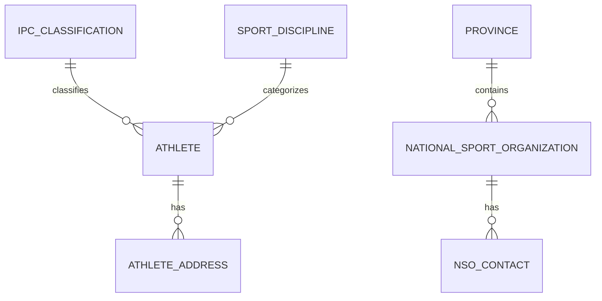

# AAPMIS Core data model

Captured from the Power Apps maker portal on 2026-11-20 in environment `dev-jts745`.

Source: [AAPMIS Core solution](https://make.powerapps.com/environments/43f231dd-2458-e4de-8f46-d3c629f1f9f2/solutions/63ce6086-9976-47a3-bc02-1a3d701d82e0/objects/apps).

## Scope

The solution lists 12 Dataverse tables: eight custom `pch_` tables and four Microsoft platform tables. The column catalog below covers all columns on the eight custom tables, with the 17 common Dataverse columns documented once. The relationship map covers the business relationships shown in the custom tables' Relationships grids; platform audit, ownership, activity, document, and process relationships are summarized separately.

## Tables at a glance

| Table | Schema name | Custom columns | Total columns | Role |
| --- | --- | ---: | ---: | --- |
| Athlete | `pch_athlete` | 33 | 51 | Athlete identity, eligibility, consent, and contacts |
| Athlete Address | `pch_athleteaddress` | 13 | 30 | Address history for an athlete |
| IPC Classification | `pch_ipcclassification` | 4 | 21 | Classification lookup |
| National Sport Organization | `pch_nationalsportorganization` | 13 | 30 | Bilingual organization and contact details |
| NSO Contact | `pch_nsocontact` | 7 | 24 | People associated with an NSO |
| Province | `pch_province` | 5 | 22 | Bilingual province lookup |
| Sport (Obsolete) | `pch_sport` | 4 | 21 | Legacy sport lookup |
| Sport Discipline | `pch_sportdiscipline` | 4 | 21 | Sport discipline lookup |
| Document Location | `sharepointdocumentlocation` | — | — | Microsoft document location table |
| Process Session | `processsession` | — | — | Microsoft process tracking table |
| Sharepoint Document | `sharepointdocument` | — | — | Microsoft SharePoint document table |
| System Job | `asyncoperation` | — | — | Microsoft asynchronous job table |

## Business relationships

| Child table | Lookup column | Parent table | Cardinality | Relationship schema name |
| --- | --- | --- | --- | --- |
| Athlete Address | `pch_Athlete` | Athlete | Many addresses to one athlete | `pch_athleteaddress_Athlete_pch_athlete` |
| Athlete | `pch_IPCClassification` | IPC Classification | Many athletes to one classification | `pch_athlete_IPCClassification_pch_ipcclassification` |
| Athlete | `pch_SportDiscipline` | Sport Discipline | Many athletes to one discipline | `pch_athlete_SportDiscipline_pch_sportdiscipline` |
| NSO Contact | `pch_NationalSportOrganization` | National Sport Organization | Many contacts to one organization | `pch_nsocontact_NationalSportOrganization_pch_nationalsportorganization` |
| National Sport Organization | `pch_Province` | Province | Many organizations to one province | `pch_nationalsportorganization_Province_pch_province` |

The Athlete Address `pch_Province` column is **single line of text**, not a lookup to Province. There is no direct Athlete ↔ National Sport Organization relationship in the inspected custom relationships. Sport (Obsolete) has no business relationship to Sport Discipline in this solution.

## Custom table columns

`Required` reproduces the Dataverse metadata. Generated unique identifiers can be marked required even though users do not enter them. Column names and spelling below follow the current solution metadata.

### Athlete (`pch_athlete`)

| Display name | Schema name | Data type | Required |
| --- | --- | --- | --- |
| Accept Financial Support | `pch_AcceptFinancialSupport` | Choice | No |
| Athlete | `pch_AthleteId` | Unique identifier | Yes |
| Athlete Number | `pch_AthleteNumber` | Autonumber | No |
| Canadian Citizen | `pch_CanadianCitizen` | Choice | No |
| City of birth | `pch_Cityofbirth` | Single line of text | No |
| Coach Email | `pch_CoachEmail` | Email | No |
| Coach First Name | `pch_CoachFirstName` | Single line of text | No |
| Coach Last Name | `pch_CoachLastName` | Single line of text | No |
| CSC/CSI | `pch_CSCCSI` | Choice | No |
| Date of birth | `pch_Dateofbirth` | Date only | No |
| Date of retirement | `pch_Dateofretirement` | Date only | No |
| Demographic Information | `pch_DemographicInformation` | Choice | No |
| Disclosure with MP | `pch_DisclosurewithMP` | Choice | No |
| Email Address | `EmailAddress` | Email | No |
| First Name | `pch_FirstName` | Single line of text | Yes |
| Gender | `pch_Gender` | Choice | No |
| Guardian Email Address | `pch_GuardianEmailAddress` | Email | No |
| Guardian First Name | `pch_GuardianFirstName` | Single line of text | No |
| Guardian Last Name | `pch_GuardianLastName` | Single line of text | No |
| High school graduation Year | `pch_HighschoolgraduationYear` | Whole number | No |
| IPC Classification | `pch_IPCClassification` | Lookup | No |
| Language of correspondance | `pch_Languageofcorrespondance` | Choice | No |
| Last Name | `pch_LastName` | Single line of text | Yes |
| Mobile Number | `pch_MobileNumber` | Phone number | No |
| Name | `pch_Name` | Single line of text | Yes |
| NCAA Eligibiity | `pch_NCAAEligibiity` | Choice | No |
| Number of dependants | `pch_Numberofdependants` | Whole number | No |
| Permanent resident since | `pch_Permanentresidentdate` | Date only | No |
| Personal Information Photographic Likeness | `pch_PersonalInformationPhotographicLikeness` | Choice | No |
| Province of birth | `pch_Provinceofbirth` | Single line of text | No |
| SAP Update Date | `pch_SAPUpdateDate` | Date only | No |
| Sex | `pch_Sex` | Choice | No |
| Sport Discipline | `pch_SportDiscipline` | Lookup | No |
| Unrestricted non-commercial use | `pch_Unrestrictednoncommercialuse` | Choice | No |

### Athlete Address (`pch_athleteaddress`)

| Display name | Schema name | Data type | Required |
| --- | --- | --- | --- |
| Address Line 1 | `pch_AddressLine1` | Single line of text | Yes |
| Address Line 2 | `pch_AddressLine2` | Single line of text | No |
| Athlete | `pch_Athlete` | Lookup | Yes |
| Athlete Address | `pch_AthleteAddressId` | Unique identifier | Yes |
| City | `pch_City` | Single line of text | Yes |
| Country | `pch_Country` | Single line of text | Yes |
| CSC/CSI | `pch_CSCCSI` | Choice | No |
| From Date | `pch_FromDate` | Date only | Yes |
| Name | `pch_Name` | Single line of text | No |
| Postal Code | `pch_PostalCode` | Single line of text | Yes |
| Province | `pch_Province` | Single line of text | Yes |
| SAP Updated | `pch_SAPUpdated` | Choice | No |
| To Date | `pch_ToDate` | Date only | No |

### IPC Classification (`pch_ipcclassification`)

| Display name | Schema name | Data type | Required |
| --- | --- | --- | --- |
| IPC Classification | `pch_IPCClassificationId` | Unique identifier | Yes |
| Name | `pch_Name` | Single line of text | No |
| Name_1033 | `pch_Name_1033` | Single line of text | No |
| Name_1036 | `pch_Name_1036` | Single line of text | No |

### National Sport Organization (`pch_nationalsportorganization`)

| Display name | Schema name | Data type | Required |
| --- | --- | --- | --- |
| Address Line 1 | `pch_AddressLine1` | Single line of text | No |
| Address Line 2 | `pch_AddressLine2` | Single line of text | No |
| Approved Training Centre | `pch_ApprovedTrainingCentre` | Yes/no | No |
| City | `pch_City` | Single line of text | No |
| Email | `pch_Email` | Email | No |
| English Name | `pch_Name_1033` | Single line of text | Yes |
| French Name | `pch_Name_1036` | Single line of text | Yes |
| Name | `pch_Name` | Single line of text | No |
| National Sport Organization | `pch_NationalSportOrganizationId` | Unique identifier | Yes |
| Phone Number | `pch_PhoneNumber` | Phone number | No |
| Postal Code | `pch_PostalCode` | Single line of text | No |
| Province | `pch_Province` | Lookup | No |
| Website | `pch_Website` | URL | No |

### NSO Contact (`pch_nsocontact`)

| Display name | Schema name | Data type | Required |
| --- | --- | --- | --- |
| Email | `pch_Email` | Email | No |
| First Name | `pch_FirstName` | Single line of text | Yes |
| Last Name | `pch_LastName` | Single line of text | Yes |
| Name | `pch_Name` | Single line of text | No |
| National Sport Organization | `pch_NationalSportOrganization` | Lookup | No |
| NSO Contact | `pch_NSOContactId` | Unique identifier | Yes |
| Phone Number | `pch_PhoneNumber` | Phone number | No |

### Province (`pch_province`)

| Display name | Schema name | Data type | Required |
| --- | --- | --- | --- |
| Code | `pch_Code` | Single line of text | Yes |
| English Name | `pch_Name_1033` | Single line of text | Yes |
| French Name | `pch_Name_1036` | Single line of text | Yes |
| Name | `pch_Name` | Single line of text | No |
| Province | `pch_ProvinceId` | Unique identifier | Yes |

### Sport (Obsolete) (`pch_sport`)

| Display name | Schema name | Data type | Required |
| --- | --- | --- | --- |
| Name | `pch_Name` | Single line of text | No |
| Name_1033 | `pch_Name_1033` | Single line of text | Yes |
| Name_1036 | `pch_Name_1036` | Single line of text | Yes |
| Sport | `pch_SportId` | Unique identifier | Yes |

### Sport Discipline (`pch_sportdiscipline`)

| Display name | Schema name | Data type | Required |
| --- | --- | --- | --- |
| Name | `pch_Name` | Single line of text | No |
| Name_1033 | `pch_Name_1033` | Single line of text | No |
| Name_1036 | `pch_Name_1036` | Single line of text | No |
| Sport Discipline | `pch_SportDisciplineId` | Unique identifier | Yes |

## Common Dataverse columns

Each custom table also has the following 17 platform columns. These are repeated in the portal on every custom table and are listed once here.

| Display name | Schema name | Data type |
| --- | --- | --- |
| Created By | `CreatedBy` | Lookup |
| Created By (Delegate) | `CreatedOnBehalfBy` | Lookup |
| Created On | `CreatedOn` | Date and time |
| Import Sequence Number | `ImportSequenceNumber` | Whole number |
| Modified By | `ModifiedBy` | Lookup |
| Modified By (Delegate) | `ModifiedOnBehalfBy` | Lookup |
| Modified On | `ModifiedOn` | Date and time |
| Owner | `OwnerId` | Owner |
| Owning Business Unit | `OwningBusinessUnit` | Lookup |
| Owning Team | `OwningTeam` | Lookup |
| Owning User | `OwningUser` | Lookup |
| Record Created On | `OverriddenCreatedOn` | Date only |
| Status | `statecode` | Choice |
| Status Reason | `statuscode` | Choice |
| Time Zone Rule Version Number | `TimeZoneRuleVersionNumber` | Whole number |
| UTC Conversion Time Zone Code | `UTCConversionTimeZoneCode` | Whole number |
| Version Number | `VersionNumber` | Whole number Big |

## Platform relationships and limits of this inventory

The custom table relationship grids also show standard links to User, Owner, Business Unit, Team, notes, document locations, SharePoint documents, process sessions, system jobs, duplicate records, and other Dataverse service tables. These are platform relationships rather than additional AAPMIS business relationships. The four Microsoft tables included in the solution are named above; their full Microsoft-managed column catalogs and relationships were not expanded here.

Choice option values, keys, and row data are outside this schema summary. This is a maker-portal metadata snapshot, not an exported solution definition.

